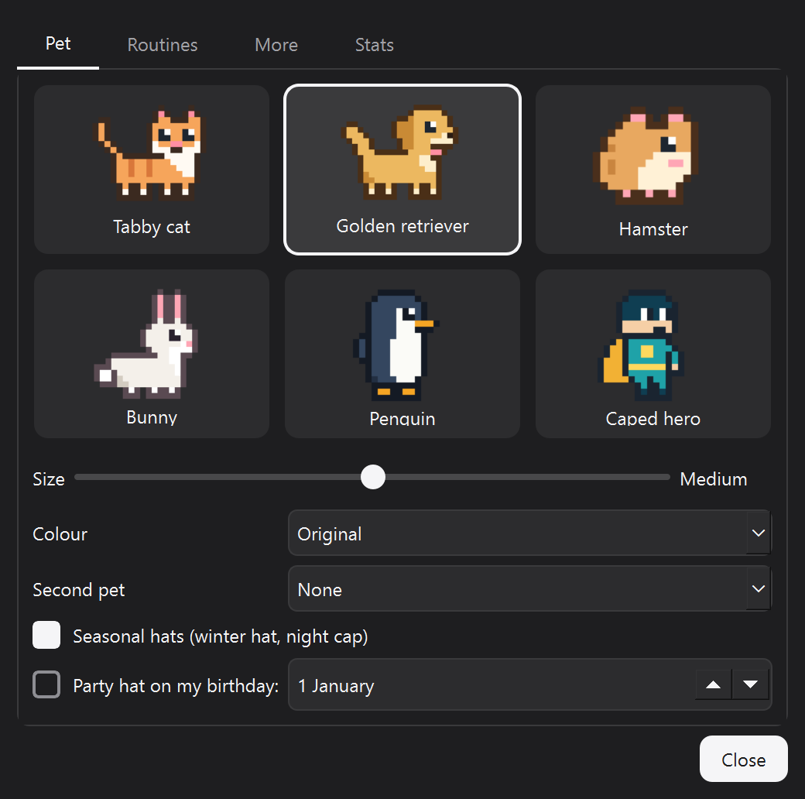
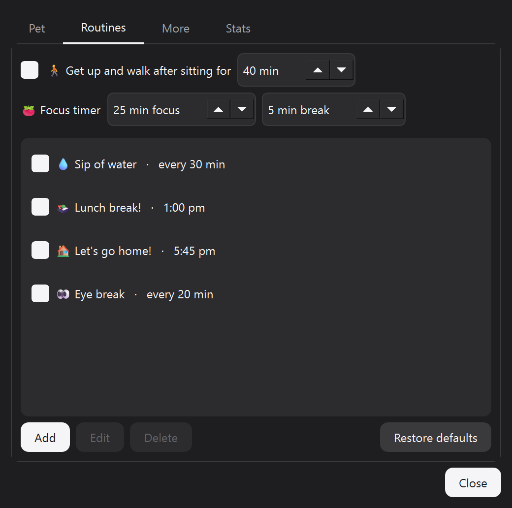

# 🐱 Desktop Pet

A lightweight pixel companion that sits atop your taskbar or Dock to encourage healthy desk habits. It **tracks desk time to prompt movement breaks**, **reminds you to hydrate, eat lunch, and log off**, **fetches local files and apps in milliseconds**, and **runs a visual cleanup animation** while clearing temporary files and the system recycle bin.

Single Python file · PyQt6 · no build step · 100% local processing.

<p align="center">
  
  
</p>

## Features

### 🩺 Health Nudges
| Reminder | Trigger |
|---|---|
| 🚶 **Get up and walk** | After **40 min** of continuous active screen time (a 5-min idle break resets it) |
| 💧 **Hydration prompt** | Every **30 min** of active screen time |
| 🍱 **Lunch break** | **1:00 PM**, once per day |
| 🏠 **End of workday** | **5:45 PM**, once per day, followed by a summary of your day |
| 👀 **Eye break** | Every **20 min**: look at something about 6 m (20 ft) away for 20 seconds |

Idle detection tracks hardware input activity so genuine time away from your desk counts as rest. Notifications never pile up, and routine prompts include a "10 more min" snooze option.

These are only the starting set. In **Settings → Routines** you can change them, switch them off, or add your own, either at a set time or every so many minutes of screen time, on the days you choose.

<p align="center">
  
  
</p>

### 🔎 Fast Local File & App Launcher
Double-click the cat → **Fetch a file**, and begin typing. The utility maintains an in-memory index of file names across your local fixed drives (indexing millions of entries in seconds and returning results in under 80 ms), persisted locally and updated as files change.

- **Apps:** Indexed system applications and installed package entries display prioritized at the top. Click to launch.
- **Files:** Press `Enter` or click to animate the cat retrieving the item and opening its parent folder with the target pre-selected.
- **Search syntax:** `words` (AND logic) · `!exclude` · `"exact phrase"` · `ext:pdf;docx` · `file:` · `folder:` · `app:` · `*wild?cards` · `docs\report` (path matching)
- **Keyboard shortcuts:** `Enter` launch/locate · `Shift+Enter` copy path · `Ctrl+Enter` open directly · `↑ / ↓` navigate · `Esc` dismiss · drag results directly into external apps
- **Answers:** type a sum (`12*7`, `15% of 80`, `sqrt(2)`) or a conversion (`5 km in miles`, `100 f to c`, `1 gb in mib`) and the answer appears on top. `Enter` copies it.
- **Pinned and recent:** an empty search box shows your pinned items and the last things you fetched. Right-click any result to pin it, or for *Open with…*.

### 🍅 Focus, Notes & Shortcuts
- **Focus timer:** 25 minutes of quiet (no reminders or chatter), then a 5-minute break. The countdown floats above your pet. Both lengths are adjustable.
- **Quick notes:** type `buy milk` to keep a note, or `call bank at 4pm` / `tea in 20 min` / `dentist tomorrow at 9:30am` to get a reminder at that time.
- **Clipboard history:** your last 25 copied texts, searchable. Kept only until you quit, never written to disk, and anything a password manager marks as private is skipped.
- **Screenshot helper:** opens the system's area-snip tool, then offers to save the result to Pictures.
- **Shortcuts that work anywhere (Windows):** `Ctrl+Alt+Space` Fetch (or `Ctrl+Alt+F` if another app already uses Space) · `Ctrl+Alt+V` clipboard history · `Ctrl+Alt+N` notes.
- **Quiet mode:** while a full-screen app, game or presentation runs, your pet hides and saves its reminders for later.
- **Stats:** today's screen time, breaks, water and focus sessions, plus a 7-day chart in **Settings → Stats**.

### 🐍 Storage Cleanup Mode
Double-click → **Cobra mode**. Inspect storage usage before performing any action (viewing Recycle Bin usage and old cache files); **no items are removed without explicit confirmation**. During cleanup, an interactive pixel battle animation plays until completion.

<p align="center">
  
  
</p>

Safety boundaries:
- Only temp/cache items unmodified for **24 hours or longer** are eligible for deletion.
- Modification dates are re-verified immediately prior to deletion.
- In-use and locked files are skipped safely.
- Directory junctions and symlinks are never traversed.
- All disk operations run at low background I/O priority.
- Right-click → *Preview reminders → Cobra fight (practice)* tests the animation with zero filesystem changes.

### 🐾 Choose Your Pet
Double-click → **Settings** to pick a **tabby cat, golden retriever, hamster, bunny, penguin or caped hero**, and set its size from Tiny to Huge. Each pet has its own sounds and small talk. The caped hero also shows off now and then: it fires a grapple line, zips to the top of the screen, flies across and dives back down.

- **Colours:** eleven fur (or suit) colours per pet.
- **A second pet** that wanders alongside, and says hello when the two meet.
- **Mood:** your pet gets happier when you take breaks, drink water and finish reminders, and a little sad if you keep snoozing. Hearts mean it's pleased.
- **Play:** throw a ball and it fetches it, or give it a treat.
- **Seasonal hats:** a woolly hat in winter, a night cap late in the evening, and a party hat on your birthday.
- **Window tops (Windows):** now and then it hops onto the window you're using and walks along its top edge.
- **Light or dark glass,** and an optional short sound per pet for reminders.

<p align="center">
  
  
</p>

### ✨ Visual Design
Subtle frosted glass dialogue styling, clean pixel scaling across mixed-DPI displays, and clean typographic fallbacks using system sans-serif fonts.

## One-Click Install
Download or clone this repository (unzip it first if needed), open the [`install`](install) folder, and double-click the file for your system:

| System | File |
|---|---|
| Windows | `Install Desktop Cat (Windows).bat` |
| Mac | `Install Desktop Cat (Mac).command` |

The installer sets up Python if needed, installs the required packages in a private environment, creates a **Desktop Cat** icon on your Desktop, and starts the companion. It is safe to run again. See [`install/README.txt`](install/README.txt) for security prompts and uninstall steps.

## Platform Support
| Feature | Windows 10 / 11 | macOS |
|---|---|---|
| Companion, health nudges, animations | ✅ | ✅ |
| File search | ✅ Fixed drives, updated live | ✅ Home folder, refreshed hourly |
| App search | ✅ | ✅ |
| Storage cleanup | ✅ | ❌ Finds nothing to clean; not available yet |
| Focus, notes, answers, clipboard history, stats, play | ✅ | ✅ |
| Shortcuts that work anywhere, quiet mode, window tops | ✅ | ❌ Not available yet |
| Screenshot helper | ✅ System snip tool | ✅ System screenshot tool |
| Dialogue styling | Frosted glass, dark or light | Plain dark or light tint |

macOS support has not yet been tested on a real Mac. Please open an issue if something misbehaves.

## Requirements (Manual Install)
- **Windows 10 / 11 or macOS**
- **Python 3.10+**
- **PyQt6** (or PySide6)

## Manual Installation
```bash
git clone https://github.com/typotive/pixelpet.git
cd pixelpet
pip install -r requirements.txt
python desktop_cat.py
```

**Generate Shortcuts:**
Run once to create the launcher with its icon (Windows: Desktop and Start menu; macOS: an app on the Desktop). No console window appears:
```bash
python desktop_cat.py --install-shortcut
```
You can then pin it to your taskbar or Dock. Running a second instance focuses the active companion rather than launching duplicates.

**Quick Demo:**
```bash
python desktop_cat.py --demo
```
*Demo mode accelerates intervals (30 s movement alert, 45 s hydration alert) for quick evaluation.*

## Controls
| Action | Response |
|---|---|
| Single Click | Display status (current desk duration, next break) or dismiss prompt |
| Single Click (during focus) | Time left, or stop the focus timer |
| Double Click | Open action menu (**Fetch**, **Focus**, **Note**, **Play**, **Screenshot**, **Cleanup mode**, **Settings**) |
| Right Click | Context menu (Status, Fetch, Clipboard, Notes, Focus, Screenshot, Play, Today's summary, Cleanup, Timer Reset, Animation Previews, Settings, Reindex, Quit) |
| Click & Drag | Reposition companion across displays |

## Configuration
Pet, size, colours, sitting limit, routines, focus lengths, theme, sounds and shortcuts are set in the **Settings** window and saved in `settings.json`. Everything else can be defined within the `Config` dataclass in `desktop_cat.py`. The flags below override the saved settings for one run, and nothing is saved during that run:

| Parameter | Default | Command Line Argument |
|---|---|---|
| `alert_after_s` (continuous sitting threshold) | 40 min | `--alert-minutes 40` |
| `idle_threshold_s` (break detection threshold) | 5 min | `--idle-minutes 5` |
| `water_every_s` (hydration interval) | 30 min | `--water-minutes 30` |
| `lunch_time` / `home_time` | 13:00 / 17:45 | `--lunch 13:00 --home 17:45` |
| `routine_days` | All days | e.g. `(0, 1, 2, 3, 4)` for Mon–Fri |
| `index_roots` | Fixed local drives | `--index D:\Work` (repeatable) |
| `fetch_trip` | Enabled | `False` disables animation for instant opens |
| `cobra_min_age_h` | 24 hours | Age cutoff for temporary file cleanup |

## Data & Privacy
All computation occurs locally on your machine. No telemetry or personal data is collected or transmitted over the network. The local search index, your settings, notes and daily screen-time stats are stored exclusively within `%LOCALAPPDATA%\DesktopCat\` (macOS: `~/Library/Application Support/DesktopCat/`) and can be purged at any time. Clipboard history is kept in memory only and is gone when you quit.

## Project Structure
```
desktop_cat.py        Application source and logic
desktop_cat.ico       Application icon asset
install/              One-click installers for Windows and macOS
requirements.txt      Runtime dependencies
docs/screenshots/     Visual documentation assets
CLAUDE.md             Architecture reference, implementation notes, and testing guidelines
```

## License
Distributed under the [MIT License](LICENSE).
